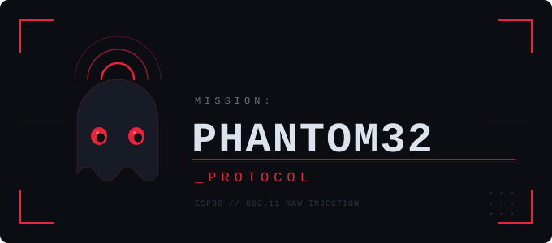

# Mission: Phantom32_Protocol



A maxed-out WiFi/BLE security research toolkit for ESP32 family boards.  
Connect to its AP, open a browser, and get a full offensive + defensive suite with no SD card required.

> **33 tools** · raw 802.11 injection · WPA2 + WPA3 coverage · BLE 5.0 · passive IDS

---

## Supported Boards

| Environment | Board | Flash | Notes |
|---|---|---|---|
| `doom` | ESP32 DevKit / WROOM-32D/U | 4 MB | Primary classic board |
| `doom_nodemcu` | NodeMCU-32S | 4 MB | Same die, CP2102 USB |
| `doom_wrover` | ESP32-WROVER-B | 4 MB | +PSRAM, extra RAM for large captures |
| `doom_m5stack` | M5Stack Basic/Gray/Fire | 4 MB | Built-in LCD (see Display section) |
| `doom_m5core2` | M5Stack Core2 | 16 MB | Touch LCD, AXP192 PMU |
| `doom_ttgo` | TTGO T-Display | 4 MB | 1.14" TFT |
| `doom_tcall` | TTGO T-Call (SIM800L) | 4 MB | GSM modem on UART |
| `doom_heltec` | Heltec WiFi Kit 32 | 4 MB | OLED on SDA=4,SCL=15 |
| `doom_s3` | Seeed XIAO ESP32-S3 (**default**) | 8 MB | BLE5, USB CDC, PSRAM |
| `doom_s3_devkit` | ESP32-S3-DevKitC-1 | 8 MB | BLE5, USB CDC |
| `doom_tdisplay_s3` | Lilygo T-Display-S3 | 16 MB | BLE5, 1.9" TFT |
| `doom_m5cores3` | M5Stack CoreS3 | 16 MB | BLE5, 2" touch LCD |
| `doom_c3` | Seeed XIAO ESP32-C3 | 4 MB | BLE5, RISC-V ★ |

> ★ ESP32-C3 requires the RISC-V toolchain. On Apple Silicon install Rosetta 2 first:
> ```bash
> softwareupdate --install-rosetta
> ```

---

## Installation

### 1. Install PlatformIO

```bash
pip install platformio
```

Or install the [VS Code PlatformIO extension](https://platformio.org/install/ide?install=vscode).

### 2. Clone / open the project

```bash
cd esp32-doom
```

### 3. Build & flash

```bash
# Flash the default board (Seeed XIAO ESP32-S3):
pio run -e doom_s3 -t upload

# Flash ESP32 WROOM-32:
pio run -e doom -t upload

# Flash M5Stack Core2:
pio run -e doom_m5core2 -t upload

# Flash filesystem (LittleFS) — only needed first time:
pio run -e doom_s3 -t uploadfs
```

### 4. Connect

1. On your phone or laptop, connect to WiFi: **`Phantom32`** / password **`phantom32`**
2. Open **`http://192.168.4.1`** in a browser.
3. If you don't see the UI, your device triggered a captive portal — tap "Sign in" / the notification.

---

## Web UI

The UI has eight tabs:

| Tab | Contents |
|---|---|
| **Dashboard** | Live heap / uptime / active tool / board; quick-start buttons |
| **WiFi Attacks** | All WiFi injection tools with scan bar |
| **BLE** | Bluetooth Low Energy spam tools |
| **Passive** | Handshake capture, PMKID, Evil Portal, Honeypot, Probe Harvest |
| **Hardware** | I2C / SPI / UART sniffers |
| **Files** | PCAP file manager (list / download / delete) |
| **Aegis** | Passive IDS dashboard (embedded) |
| **CLI** | Full command-line interface with tab-complete & history |

### Scan bar (WiFi tab)

Click **Scan APs** at the top of the WiFi tab.  
Select any AP from the dropdown — BSSID, channel, and SSID are auto-filled into every tool card.

### Tool cards

Click a card header to expand it.  
Fill in parameters (dropdowns for mode/channel/reason, number inputs for counts, MAC address fields) then click **▶ Start**.  
A green pulse on the card confirms the tool is running.  
Click **■ Stop** or start another tool (only one WiFi tool at a time).

### Files tab

After a Handshake or PMKID capture, switch to **Files** to download the `.pcap` to your computer.  
Use Hashcat or Wireshark to crack / analyze the capture offline.

---

## Tools Reference

### WiFi Attacks

#### Deauth
Sends 802.11 deauthentication + disassociation frames in both directions (AP→STA and STA→AP spoofed reverse), 4 frames per burst at 5 ms intervals.

| Field | Default | Description |
|---|---|---|
| Target BSSID | `FF:FF:FF:FF:FF:FF` | AP to deauthenticate from |
| Channel | 6 | Operating channel |
| Reason | 7 (Class 3) | Deauth reason code (1–24) |
| Broadcast | ✓ | Send to broadcast — deauths all clients |

CLI: `deauth AA:BB:CC:DD:EE:FF ch=6 reason=7 broadcast=1`

---

#### Deauth Storm ⚡ *(new)*
Nuclear multi-vector deauth that cycles 8 attack vectors in rapid rotation.  
Covers both **WPA2** and **WPA3** APs — no need to know which you're targeting.

| Vector | Frame type | Purpose |
|---|---|---|
| 1 | Deauth AP→STA | Standard WPA2 deauth |
| 2 | Disassoc AP→STA | Association table eviction |
| 3 | Deauth STA→AP (spoofed) | PMF bypass for transition mode |
| 4 | Disassoc STA→AP (spoofed) | PMF bypass for transition mode |
| 5–6 | SAE Commit flood | WPA3 state machine exhaustion |
| 7 | PMKID Assoc flood | WPA3 AP CPU drain |
| 8 | BTM Request | Force roam (iOS/Android/Windows) |

CLI: `stormdeauth AA:BB:CC:DD:EE:FF ch=6`

---

#### WPA3 Flood
SAE (Dragonfly) handshake flood against WPA3-Personal APs.

| Mode | Description |
|---|---|
| `commit` | SAE Commit flood — exhausts AP SAE state machine |
| `confirm` | SAE Confirm flood |
| `both` | Alternate Commit + Confirm |
| `eapstart` | EAP-Start flood |
| `transition` | Unprotected deauth BC + SAE commit — **best for WPA3-Transition APs** |
| `pmkid` | PMKID assoc flood — drains AP CPU regardless of PMF |

> **WPA3 deauth guide:** For WPA3-Transition (mixed WPA2/WPA3), use `transition` mode — it hits WPA2 clients with unprotected deauths while simultaneously exhausting the SAE state machine. For WPA3-only with PMF Required, use `both` or `pmkid`. For maximum coverage use **Deauth Storm** which applies all vectors automatically.

CLI: `wpa3flood AA:BB:CC:DD:EE:FF ch=6 mode=transition`

---

#### Multi Deauth *(new)*
Deauths up to 8 BSSIDs simultaneously, channel-hopping between them in round-robin.

| Parameter | Description |
|---|---|
| `bssid0=…&ch0=6` | Target 1 BSSID + channel |
| `bssid1=…&ch1=11` | Target 2 BSSID + channel |
| … up to `bssid7` / `ch7` | Up to 8 targets |

CLI: `multideauth bssid0=AA:BB:CC:DD:EE:FF ch0=6 bssid1=11:22:33:44:55:66 ch1=11`

---

#### Beacon Spam
Floods the air with fake access points.

| Field | Default | Description |
|---|---|---|
| SSID | `Free WiFi` | Beacon SSID (or base name for random) |
| Count | 200 | Beacons to send (0 = continuous) |
| Random SSIDs | ✓ | Randomise SSID and BSSID each frame |

CLI: `beacon "Free WiFi" count=500 random=1`

---

#### Probe Flood
Sends probe request frames as if hunting for a network.

CLI: `probe TestNet count=1000`

---

#### Evil Twin
Clones a real AP (deauths clients from it, lures them to the rogue AP, serves a captive portal that steals credentials).

| Field | Description |
|---|---|
| Clone SSID | Name of the network to impersonate |
| Target BSSID | Real AP MAC — deauth source |
| Channel | Channel to operate on |

Credentials appear under the **📋 Creds** button, also at `/api/eviltwin/creds`.

---

#### Auth Flood
Floods an AP's association table.

| Mode | Description |
|---|---|
| 0 – Auth only | Sends auth requests |
| 1 – Assoc only | Sends association requests |
| 2 – Auth+Assoc | Both (table overflow) |
| 3 – Disassoc BC | Disassociate broadcast |
| 4 – All three | Rotate through all types |

---

#### KARMA
Answers every probe request with a matching AP advertisement. Devices with saved networks auto-connect.

| Mode | Description |
|---|---|
| Open | No password — fastest |
| WPA2 | With PSK (device may show "wrong password") |

---

#### NAV Flood
Corrupts the 802.11 virtual carrier-sense mechanism using CTS/RTS frames with max NAV duration (32767 µs).  
Causes nearby stations to defer transmission (soft DoS).

---

#### CSA Attack
Sends Channel Switch Announcement (CSA) + BTM Request + Neighbor Report action frames to force clients to roam to a non-existent or attacker-controlled channel.

---

#### BTM Flood *(new)*
802.11v BSS Transition Management (BTM) flood — forces modern STAs (iOS, Android, Windows) to roam away from the target AP.

| Mode | Description |
|---|---|
| 0 – BTM Request | BSS Transition Request flood |
| 1 – Neighbor Report | Neighbor Report flood |
| 2 – Both | Alternate both |

| Field | Description |
|---|---|
| `bssid` | Target AP BSSID |
| `ch` | AP channel |
| `redirect_ch` | Channel to redirect clients to (default 13) |
| `broadcast` | 1 = send to broadcast DA |

---

#### EAP Flood *(new)*
WPA Enterprise (802.1X) EAPOL state machine exhaustion. Sends EAPOL frames from random locally-administered MACs to drain the AP's RADIUS thread pool.

| Mode | Description |
|---|---|
| 0 – EAPOL Start | Trigger RADIUS EAP negotiation |
| 1 – EAP Identity | Flood EAP Identity responses |
| 2 – EAPOL M1 | EAPOL handshake message 1 flood |
| 3 – All | Rotate through all types |

---

#### Null Flood *(new)*
Power-save state machine confusion. Alternates the Power Management (PM) bit in null data / QoS-null / PS-Poll / BAR frames to confuse AP buffering state machines.

| Mode | Description |
|---|---|
| 0 – Null+QoS-Null | PM bit toggle on every frame |
| 1 – PS-Poll | PS-Poll flood |
| 2 – BAR | Block ACK Request flood |
| 3 – All | Rotate through all |

---

#### Mgmt Spray *(new)*
Sprays all 8 management frame subtypes in rapid rotation from random locally-administered MACs.

| Phase | Frame type |
|---|---|
| 0 | Probe Request |
| 1 | Authentication |
| 2 | Association Request |
| 3 | Reassociation Request |
| 4 | Deauth STA→AP |
| 5 | Disassoc STA→AP |
| 6 | Action BTM |
| 7 | ATIM |

---

#### Action Flood *(new)*
Sprays 802.11 action frames across all major categories with random payloads.

| Mode | Category | Description |
|---|---|---|
| `random` | All (0,1,2,3,5,7,8,9,10,17) | Random category rotation |
| `spectrum` | 0 | Spectrum Management |
| `blockack` | 3 | ADDBA (Block ACK) |
| `saquery` | 8 | SA Query |
| `wnm` | 10 | WNM Sleep Mode (action 7) |

---

#### ESP-NOW Flood
Sends ESP-NOW broadcast frames to the target MAC.  
Useful for flooding ESP-NOW mesh networks or discovering ESP-NOW receivers.

---

#### Advanced Frames (Adv Frames)
Injects specialty management frames:

| Mode | Description |
|---|---|
| `wps` | WPS beacon injection |
| `fuzz` | Random IE fuzzer |
| `overflow` | Information Element buffer overflow |
| `hidden` | Zero-length hidden SSID |
| `bigIE` | Oversized vendor IE |
| `ssidOverflow` | 255-byte SSID |
| `tkipMic` | TKIP MIC failure (triggers forced re-key) |
| `dupSeq` | Duplicate sequence number |
| `quiet` | Quiet IE (STA silence) |
| `wds` | WDS/4-address frame |

---

#### Chan Hop Deauth
Passively sniffs beacons on channels 1–13, builds a live AP list, then deauths every discovered AP.  
No configuration required — just start it.  
Discovered APs appear under **📋 APs found**.

---

### BLE Tools

#### BLE Spam
Triggers Bluetooth popups on nearby devices.

| Mode | Target |
|---|---|
| `apple` | Random Apple Continuity (AirPods, iOS popups) |
| `continuity` | All Apple Continuity sub-types |
| `airdrop` | AirDrop flood (iOS "AirDrop from…") |
| `handoff` | Handoff / Universal Clipboard |
| `android` | Android FastPair popup |
| `googlenearby` | Google Nearby Share |
| `windows` | Windows SwiftPair popup |
| `swiftpair` | Named SwiftPair device |
| `samsung` | Samsung BLE |
| `airtag` | AirTag clone |
| `ibeacon` | Apple iBeacon |
| `eddystone` | Google Eddystone-URL |
| `namespam` | Random device name flood |
| `scan` | BLE scan request flood |
| `rapidflood` | Random BLE advertisement flood |

> On ESP32-S3 and ESP32-C3 (BLE 5.0), the firmware advertises at BLE5 2M PHY for increased range.

CLI: `ble apple` / `ble windows` / `ble rapidflood`

---

### Passive / Monitor

#### Probe Harvest *(new)*
Passively sniffs the air for 802.11 probe requests and builds a map of:
- **Device MAC addresses** — who is nearby
- **SSID history** — what networks they've previously connected to (their saved network list)
- **Signal strength (RSSI)** — how close they are

No frames transmitted — completely passive.  
Stored in RAM (up to 128 entries). View results via **📋 Devices** button.  
Also available at `/api/probeharvest/results`.

This is the first step before an Evil Twin or KARMA attack — you can see which SSID a device is probing for and clone it precisely.

---

#### Handshake Grab
Listens for EAPOL 4-way handshake frames and saves them to a `.pcap` on LittleFS.  
Enable **Force deauth** to send 20 deauth frames first (makes clients re-authenticate).

After capture → **Files** tab → Download `.pcap` → crack with:

```bash
hashcat -m 22000 capture.pcap wordlist.txt
# or
aircrack-ng capture.pcap -w wordlist.txt
```

---

#### PMKID Hunt
Sends EAPOL frame 1 to the AP and captures the PMKID from the response — no client required.  
Saves to LittleFS as `.pcap`.

```bash
# crack with hcxtools:
hcxpcapngtool capture.pcap -o hashes.txt
hashcat -m 22000 hashes.txt wordlist.txt
```

---

#### Evil Portal
Opens a captive portal that serves a fake login page on `http://192.168.4.1`.  
Credentials are stored in memory and shown via the **📋 Creds** button.

---

#### Honeypot
Opens TCP listeners on ports 22 (SSH banner), 80 (HTTP), and 2323 (Telnet).  
Logs every connection attempt and any data sent. View log at `/api/honeypot/log`.

---

### Hardware Tools

> Pin defaults are auto-filled based on the detected board.  
> Override any pin number before starting.

#### I2C Sniff
Acts as an I2C slave and logs every byte from the master.

| Field | Default (ESP32) | Default (S3 XIAO) |
|---|---|---|
| SDA | 21 | 5 |
| SCL | 22 | 6 |
| Address | 0x50 | 0x50 |

Log at `/api/i2c/log`

#### SPI Sniff
ISR-safe MOSI sampler — samples MOSI on every CLK edge.

| Field | Default (ESP32) | Default (S3 XIAO) |
|---|---|---|
| CLK | 18 | 7 |
| MOSI | 23 | 9 |
| CS | 5 | 44 |

Log at `/api/spi/log`

#### UART Bridge
Bridges UART1 to USB serial. Useful for man-in-the-middle of UART debug ports.

| Field | Default (ESP32) | Default (S3) |
|---|---|---|
| RX | 16 | 44 |
| TX | 17 | 43 |
| Baud | 115200 | 115200 |

---

## CLI Reference

Access the CLI on the **⌨ CLI** tab, or via HTTP:

```bash
curl -X POST http://192.168.4.1/api/cli -d "help"
```

### Core commands

| Command | Description |
|---|---|
| `help` | Show all categories |
| `help <cmd>` | Detailed help for a command |
| `status` | Heap, uptime, active tool |
| `modules` | List all tool slugs |
| `start <slug> [key=val …]` | Start a tool |
| `stop [slug]` | Stop the active (or named) tool |
| `reboot` | Soft-restart the ESP32 |

### Quick shortcuts

```
d AA:BB:CC:DD:EE:FF ch=6     → deauth
b "Free WiFi" random=1        → beacon
p TestNet                     → probe
hs AA:BB:CC:DD:EE:FF force=1  → handshake
bt apple                      → ble spam
stormdeauth AA:BB:.. ch=6    → multi-vector WPA2+WPA3 deauth
```

### Defence (Aegis IDS)

```
aegis           → summary
scan            → cached AP list
clients         → nearby stations
events          → recent IDS alerts
attackers       → ranked deauth attackers
channels        → per-channel frame counts
trust HomeNet AA:BB:CC:DD:EE:FF 6
untrust
```

### Safety limits

```
safety                       → show current limits
safety dps=50 bps=100 ast=30 → set deauth/beacon pps + auto-stop
block AA:BB:CC:DD:EE:FF      → block a BSSID from attack
unblock                      → clear blocklist
```

### Diagnostics

```
diag channel     → per-channel management frame counts
diag heatmap     → RSSI histogram
diag clients     → client inventory with vendor OUI
diag ies AA:BB:CC:DD:EE:FF  → decode AP information elements
diag packets     → recent management frames
```

---

## Device-Specific Notes

### ESP32-S3 / ESP32-C3 (BLE 5.0)
- BLE advertisements use 2M PHY for extended range.
- USB CDC serial is active (`-DARDUINO_USB_CDC_ON_BOOT=1`).
- When flashing the XIAO S3: hold BOOT button while plugging in USB if the port doesn't appear.

### ESP32-C3 (Apple Silicon Mac)
The RISC-V toolchain is x86-only. Install Rosetta 2 first:
```bash
softwareupdate --install-rosetta
pio run -e doom_c3 -t upload
```

### M5Stack (Basic / Core2 / CoreS3)
The firmware boots normally. The LCD is not driven by default — connect to the web UI over WiFi instead.  
Default I2C: SDA=21, SCL=22. The AXP192 PMU (Core2) is on the same bus at 0x34.

### TTGO T-Display
Default pins match the standard ESP32 layout. The TFT display is not driven.

### Heltec WiFi Kit 32
I2C on SDA=4, SCL=15 (the OLED bus). Set those pins if using the I2C sniff tool.

---

## Architecture

```
src/
  main.cpp          — setup(), loop(), AP/server init, tool registry
  module.h          — ToolModule struct, g_tools[], tool_register/start/stop
  hub_html.h        — PROGMEM HTML/CSS/JS for the web UI
  board.h           — board detection, /api/board route, pin defaults
  cli.h             — full CLI dispatcher, /api/cli route
  aegis.h           — passive WiFi IDS
  aegis_ble.h       — BLE advertisement scanner
  safety.h          — rate limiter, blocklist, auto-stop
  persist.h         — NVS profile save/load
  diag.h            — diagnostics (channel map, IEs)
  capture.h         — PCAP writer (LittleFS, fsLock semaphore)
  pcap_mgr.h        — /api/pcaps, /api/pcap/dl, /api/pcap/del, /api/fs
  frames.h          — raw 802.11 frame builders (f_deauth, f_disassoc,
                       f_deauth_r, f_disassoc_r, f_actionBTM, etc.)
  bypass.cpp        — ieee80211_raw_frame_sanity_check override (enables injection)
  deauth.h          — Deauth tool (bidirectional, 4 frames/burst)
  deauth_multi.h    — Multi Deauth (up to 8 BSSIDs simultaneously)
  deauth_storm.h    — Deauth Storm (8-vector WPA2+WPA3 coordinated attack)
  beacon_spam.h     — Beacon spam tool
  probe_flood.h     — Probe request flood
  probe_harvest.h   — Passive probe request sniffer (device + SSID recon)
  handshake.h       — Handshake / PMKID capture
  evil_portal.h     — Captive portal
  evil_twin.h       — Evil Twin AP + deauth + DNS + cred capture
  honeypot.h        — TCP honeypot
  ble_spam.h        — BLE advertisement spam (15 modes)
  auth_flood.h      — Auth/assoc/disassoc flood
  karma.h           — KARMA probe response
  nav_flood.h       — CTS/RTS NAV DoS
  csa_attack.h      — Channel Switch Announcement attack
  btm_flood.h       — BTM Flood (802.11v BSS Transition Management)
  espnow_flood.h    — ESP-NOW flood
  beacon_adv.h      — Advanced beacon injection
  pmkid_hunt.h      — PMKID extraction
  wpa3_flood.h      — WPA3 SAE flood (6 modes incl. transition + pmkid exhaust)
  eap_flood.h       — WPA Enterprise EAPOL state exhaustion
  null_flood.h      — Power-save null/QoS-null/BAR confusion
  mgt_flood.h       — All-subtype management frame spray
  action_flood.h    — 802.11 action frame category spray
  chan_hop_deauth.h  — All-channel deauth sweep
  i2c_sniff.h       — I2C slave logger
  spi_sniff.h       — SPI MOSI sampler
  uart_bridge.h     — UART1 bridge
```

---

## Legal

This firmware is for **authorized security testing, research, and educational use only**.  
Deauthenticating clients, capturing credentials, or flooding radio spectrum on networks you do not own or have explicit written permission to test is illegal in most jurisdictions.  
The authors accept no liability for misuse.
